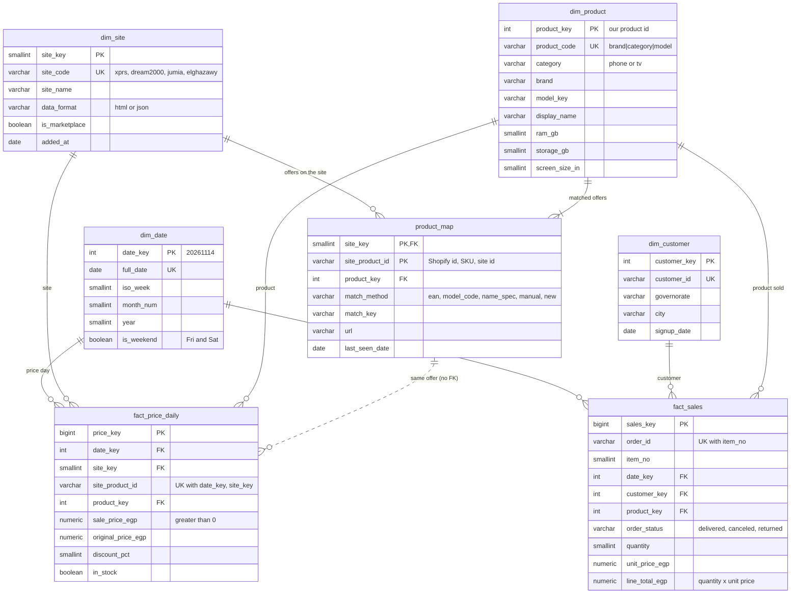

# Module 3 — Data Warehouse (PostgreSQL)

**Owner:** Eng. Hussein Saeed

> Fill each step with the command you ran, its output and a screenshot (`images/`).

## Design (data dictionary, sheet Star_Schema)
Two fact tables — `fact_price_daily` (site offer per day) and `fact_sales` (item in an order of our store) — share
`dim_product` and `dim_date`. Plus `dim_site`, `dim_customer` and the bridge `product_map` (which offer on which site is which product).
This shared product dimension is what lets us compare market prices with our sales.

## Files

| File | Task | Status |
|---|---|---|
| `scripts/schema.sql` | H2 — 7 tables, dim_date (730 days), 3 sites, keys and indexes | **done** |
| `../05_etl/scripts/etl_state.sql` | control table of both pipelines | **ready** |
| `images/erd.png` | H2 — ERD from the created schema (DBeaver ER diagram) | **done** (103,670 bytes) |

## Steps

### 1. Create the warehouse (H2, H3)
Run `scripts/schema.sql` then `05_etl/scripts/etl_state.sql` in DBeaver (`localhost:5433`, database `ecommerce_dw`).
```
Get-Content -Raw "03_dwh\scripts\schema.sql" | docker exec -i ecommerce-postgres-dw psql -U dw_user -d ecommerce_dw -v ON_ERROR_STOP=1
NOTICE:  table "fact_sales" does not exist, skipping
NOTICE:  table "fact_price_daily" does not exist, skipping
NOTICE:  table "product_map" does not exist, skipping
NOTICE:  table "dim_product" does not exist, skipping
NOTICE:  table "dim_customer" does not exist, skipping
NOTICE:  table "dim_site" does not exist, skipping
NOTICE:  table "dim_date" does not exist, skipping
DROP TABLE
CREATE TABLE
INSERT 0 730
CREATE TABLE
INSERT 0 3
CREATE TABLE
CREATE INDEX
CREATE TABLE
CREATE INDEX
CREATE INDEX
CREATE TABLE
CREATE TABLE
CREATE INDEX
CREATE INDEX
CREATE INDEX
CREATE TABLE
CREATE INDEX
CREATE INDEX
CREATE INDEX
CREATE INDEX

Get-Content -Raw "05_etl\scripts\etl_state.sql" | docker exec -i ecommerce-postgres-dw psql -U dw_user -d ecommerce_dw -v ON_ERROR_STOP=1
CREATE TABLE
CREATE INDEX

-- Verify tables / views / matviews
SELECT relname, relkind FROM pg_class WHERE relnamespace='public'::regnamespace AND relkind IN ('r','v','m') ORDER BY relname;
 dim_customer     | r
 dim_date         | r
 dim_product      | r
 dim_site         | r
 etl_state        | r
 fact_price_daily | r
 fact_sales       | r
 product_map      | r
(8 rows)

SELECT COUNT(*) FROM dim_date;
 dim_date_rows
---------------
           730

SELECT site_key, site_code, site_name, platform, data_format, is_marketplace FROM dim_site ORDER BY site_key;
 site_key | site_code |  site_name  | platform | data_format | is_marketplace
----------+-----------+-------------+----------+-------------+----------------
        1 | xprs      | XPRS        | Shopify  | json        | f
        2 | dream2000 | Dream 2000  | Shopify  | json        | f
        3 | jumia     | Jumia Egypt |          | html        | t
-- (output of 3-Nov-2026; from 9-Nov schema.sql adds row 4: elghazawy | El Ghazawy | | html | f)

-- fact_sales has 14 columns; line_total_egp is generated ALWAYS
SELECT table_name, column_name, is_generated FROM information_schema.columns WHERE table_name='fact_sales' ORDER BY ordinal_position;
(14 rows, line_total_egp | ALWAYS, all others NEVER)

-- 25 indexes, 39 constraints (pk+uk+ck+fk) as required by the data dictionary
SELECT COUNT(*) FROM pg_indexes WHERE schemaname='public';       -- 25
SELECT COUNT(*) FROM pg_constraint WHERE connamespace='public'::regnamespace AND contype IN ('c','f','u','p');  -- 39
```

### 2. ERD (H2)
DBeaver → database → ER Diagram → export PNG to `images/erd.png`.

```
FullName                                                            Length
E:\project-nha5\ecommerce-data-pipeline-main\03_dwh\images\erd.png  103670
```

The ERD shows: `product_map → dim_site`, `product_map → dim_product`, `fact_price_daily → dim_date / dim_site / dim_product`,
`fact_sales → dim_date / dim_customer / dim_product`, plus the 3 analysis views and the materialized view.

The same ERD as a diagram that GitHub draws from text (main columns; the dashed line = same offer, no foreign key):



## Deliverables
- [x] `schema.sql` · [x] `images/erd.png` · [ ] screenshots of the tables and counts (to add)