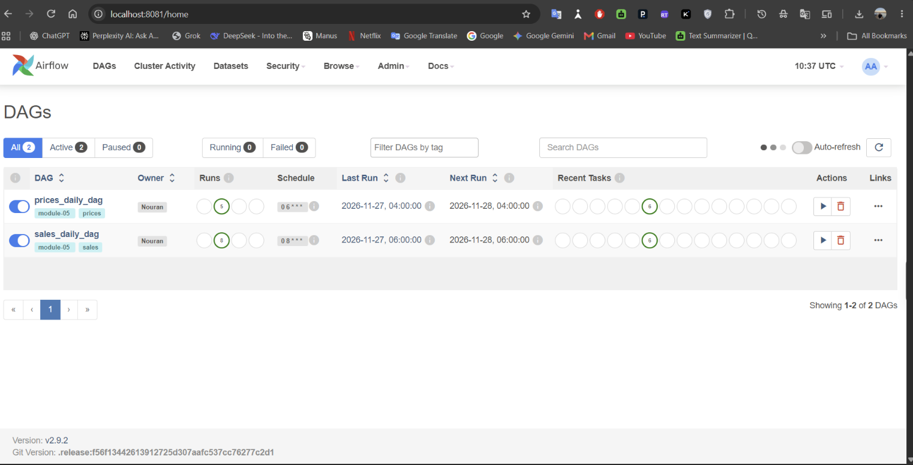
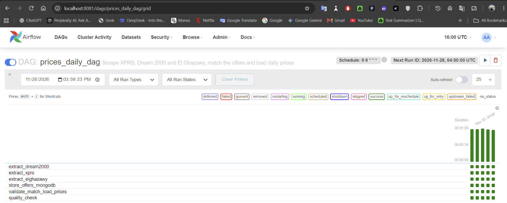
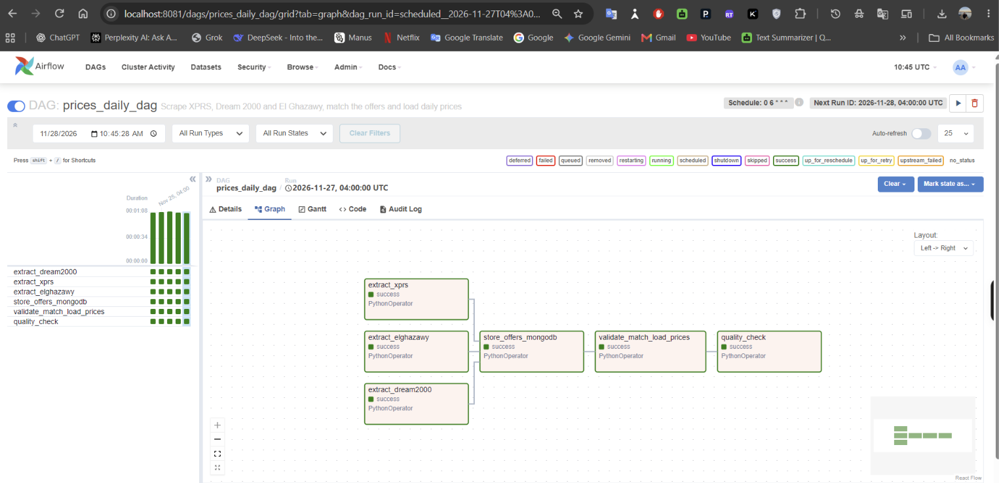
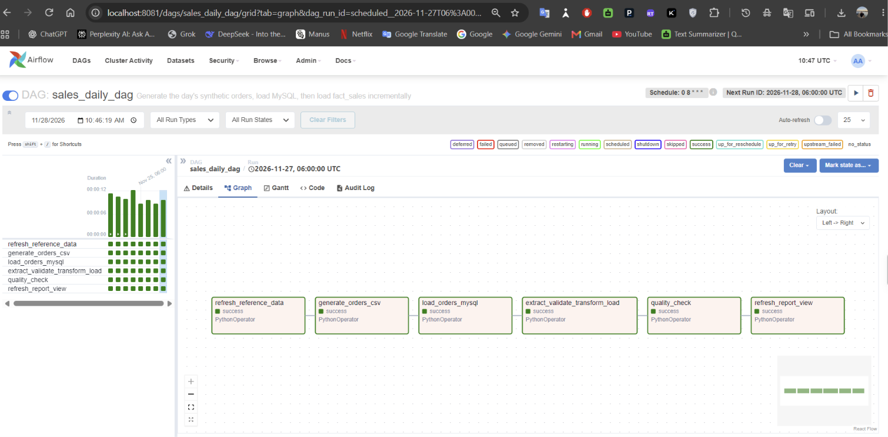
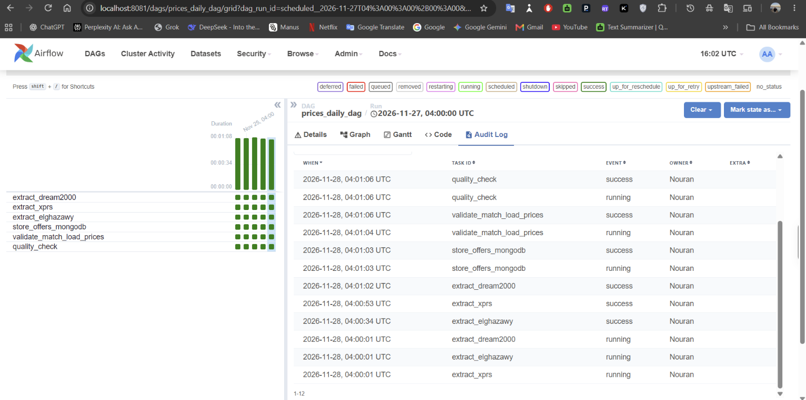

# Module 5 — ETL and Pipelines (Python and Apache Airflow)

**Owner:** Eng. Nouran Elshwehy

> Fill each step with the command you ran, its output and a screenshot (`images/`).

## Two pipelines

| Pipeline | DAG | Flow | etl_state.pipeline |
|---|---|---|---|
| Prices | `dags/prices_daily_dag.py` (06:00 Cairo) | 3 scrapers (XPRS, Dream 2000, El Ghazawy) → MongoDB → validate + **match** + load `fact_price_daily` → quality check | `prices_daily` |
| Sales | `dags/sales_daily_dag.py` (08:00 Cairo) | generate the day's orders → MySQL → incremental load `fact_sales` → quality check | `orders_incremental` |

Both commit facts and the `etl_state` row in one transaction; a failed run is recorded and re-raised (Airflow retries).

**Sites (9-Nov-2026):** Jumia answers HTTP 403 since 2-Nov-2026, so `prices_daily_dag.SITES` is now `dream2000, xprs, elghazawy`. The quality check receives the same list (`check_prices(..., sites=SITES)`): a site the team stopped on purpose is not counted as "0 offers today", but a site of the list that returns too few offers still fails the DAG (70% rule). Jumia's prices of 27-Oct to 1-Nov stay in the warehouse.

## Files

| File | Task | Status |
|---|---|---|
| `scripts/mysqlconnect.py`, `scripts/postgresqlconnect.py` | connections (settings from `.env`) | **ready** |
| `scripts/etl_common.py` | watermark, run log, MongoDB connection | **ready** |
| `scripts/etl_state.sql` | control table | **ready** |
| `scripts/matching.py` | N2 — the integration step | **done** |
| `scripts/load_prices.py` | N3 — MongoDB → `fact_price_daily` | **done** |
| `scripts/automation.py` | N4 — MySQL → `fact_sales` (incremental) | **done** |
| `scripts/quality_checks.py` | N5 / N6 — checks that fail the DAG | **done** |
| `dags/prices_daily_dag.py`, `dags/sales_daily_dag.py` | N5 / N6 | **DAG ready, quality_check wired** |
| `config/*.csv` | matching lists (see `config/README.md`) | **filled** by A7 |
| `scripts/matching_views.sql` | crosswalk + matching status + review list (views for DBeaver / Power BI) | **done** (6-Nov) |
| `scripts/match_review.py` | level 3: the manual matching tool (export / import) | **done** (6-Nov), 12 tests |

## Matching in three levels (instructor's request, 6-Nov-2026)

| Level | How | Where | `match_method` |
|---|---|---|---|
| 1. Barcode | same EAN / GTIN on two sites | `matching.py` (used when a site gives a barcode) | `ean` |
| 2. Composite key (regex) | phones: brand + model + RAM + storage (e.g. `samsung\|phone\|a57\|8\|256`); TVs: brand + model code (e.g. `samsung\|tv\|43F6000F`) | `matching.py` + `config/*.csv` | `name_spec`, `model_code` |
| 3. Manual tool | a person links what levels 1–2 could not match, helped by suggestions | `match_review.py` → `config/manual_matches.csv` (applied first at every load) | `manual` |
| — | no key (title without model or memory) | the offer stays a single-site product | `new` |

**The crosswalk table** (our product id next to each site's id): `product_map` stores one row per site offer → `product_key`. The view `v_product_crosswalk` shows one row per product with `xprs_product_id` (Shopify `handle:variant_id`), `dream2000_product_id` (Shopify), `jumia_product_id` (SKU), `elghazawy_product_id`, the URL on each site and `other_sites` (any later site).

**Which products are matched and which are not:** `v_matching_status` (per category and site: offers, matched, single-site, % matched, and how many by each level) and `v_unmatched_offers` (the review list).

Setup (once, after `etl_state.sql`): run `05_etl/scripts/matching_views.sql` in DBeaver.

Weekly review (about 15 minutes):
```
python 05_etl/scripts/match_review.py export
-> 602 unmatched offers = 412 products, 42 with a suggestion -> data/review/match_review_2026-11-06.csv
```
Open the file in Excel. One product per group (its colour variants together, ids joined by `;`), up to 3 suggestions, the most similar first. Suggestions are only products of the same brand and category, the same storage (phones) or screen size (TVs), the same model numbers (Note 15 is never suggested for Note 17) and, for phones, the same variant words (Pro, Plus, Ultra, Lite, …). Check both links, then write `yes` in `decision` next to the right suggestion, or a product code in `other_product_code`. Save as CSV, then:
```
python 05_etl/scripts/match_review.py import data/review/match_review_2026-11-06.csv --by "Nouran" --apply-db
-> 1 manual matches added to 05_etl/config/manual_matches.csv
-> 1 offers moved in the warehouse
```
`--apply-db` moves the offer and its past price rows to the chosen product at once; without it the change applies at the next price load. Commit `manual_matches.csv` to GitHub (it is the record of who checked what, and when).

Test (6-Nov-2026, Aya's 13 daily files + a sample of 90 Elghazawy offers): the reviewer accepted XPRS `43F6000` → `43F6000F`; after the next load the offer stayed `manual` and the product was on 4 sites. Phones 75.9 % of offers matched, TVs 34.5 %.

## Steps

> **Note (review of 3-Nov-2026):** the outputs below that show 3 products, 8 price rows or 108 sales lines were produced with the test seed (`05_etl/tests/fixtures/seed_mongo.py`, 8 hand-written offers), not with scraped data. Replace them with the outputs of a run on the real offers files before the final presentation. A review run on all the real daily files (27-Oct to 2-Nov-2026, 7,530 offers) gave: 7,508 price rows, **143 phones and 30 TVs on 2+ sites on 29-Oct** (the day with the three sites), 181 products sold by our store, 511 order items over 6 days. See `REVIEW_FIXES.md`.

### 1. Start the services (N1)
`cp .env.example .env` then `docker compose up -d`; Airflow UI at http://localhost:8081.
```
docker compose ps
NAME                                               STATE     STATUS
ecommerce-data-pipeline-main-airflow-scheduler-1   running   Up ... (healthy)
ecommerce-data-pipeline-main-airflow-webserver-1   running   Up ... (healthy)
ecommerce-data-pipeline-main-postgres-1            running   Up ... (healthy)
ecommerce-mongodb                                  running   Up ...
ecommerce-mysql                                    running   Up ... (healthy)
ecommerce-postgres-dw                              running   Up ... (healthy)
```

### 2. Matching (N2) and price load (N3)
```
$env:MONGO_HOST="localhost";$env:MONGO_PORT="27017";$env:MONGO_USER="mongo_admin";$env:MONGO_PASSWORD="mongo_password";$env:MONGO_DB="catalog"
python 05_etl\scripts\load_prices.py
2026-10-31 ... INFO 2026-10-31 -> 8 offers, 8 inserted, checksum=217692.00

-- products on 2+ sites (matching quality)
SELECT COUNT(*) FROM dim_product;   -- 3
SELECT COUNT(*) FROM product_map;   -- 8
SELECT match_method, COUNT(*) FROM product_map GROUP BY match_method;
 name_spec  | 3
 model_code | 5

-- fact_price_daily per day
SELECT COUNT(*), MIN(sale_price_egp), MAX(sale_price_egp), SUM(sale_price_egp) FROM fact_price_daily;
 8 | 23500.00 | 30299.00 | 217692.00
```

### 3. Sales load (N4)
`python 05_etl/scripts/automation.py` — run twice: the second run must report no_data.
```
# run 1: full load
python 05_etl\scripts\automation.py
{'status': 'success', 'rows_in': 108, 'rows_out': 108}

# run 2: watermark prevents re-loading
python 05_etl\scripts\automation.py
{'status': 'no_data', 'rows_in': 0, 'rows_out': 0}

-- verification
SELECT COUNT(*) FROM fact_sales;              -- 108
SELECT COUNT(*) FROM dim_customer;            -- 3000
SELECT SUM(quantity), SUM(line_total_egp) FROM fact_sales;
 117 | 3188854.39

SELECT pipeline, status, batch_id, rows_in, rows_out, checksum FROM etl_state ORDER BY run_id;
 prices_daily       | failed  |            |   0 |   0 |          --
 prices_daily       | success | 2026-10-31 |   8 |   8 |   217692.00
 orders_incremental | success | 2026-10-31 | 108 | 108 | 3188854.39
```

### 4. DAGs (N5, N6)
**Screenshots of the daily runs on the Azure VM (28-Nov-2026):** both DAGs run by themselves, with no manual trigger.

| # | Screenshot | What it shows |
|---|---|---|
| 1 |  | Both DAGs are active: 0 running, 0 failed. `prices_daily_dag` runs at 06:00 and `sales_daily_dag` at 08:00 (Cairo time). |
| 2 |  | Grid view of `prices_daily_dag`: 5 runs, all 6 tasks green, about 1 minute 8 seconds per run. |
| 3 |  | Graph view: three extract tasks in parallel, then `store_offers_mongodb`, `validate_match_load_prices` and `quality_check`. All `success`. |
| 4 |  | Graph view of `sales_daily_dag`: six tasks in a chain, all `success`. |
| 5 |  | Audit log of the run of 28-Nov: it started at 04:00:01 UTC (06:00 Cairo, the scheduled time) and all six tasks succeeded by 04:01:07. |

Airflow names a run after the start of its data interval, so the run named `2026-11-27 04:00 UTC` is the one that started on 28-Nov at 04:00 UTC. Times in the Airflow screens are UTC; Cairo is UTC+2 in November.

To see the loads of every run: `SELECT * FROM etl_state ORDER BY run_id DESC;`
```
# sales_daily_dag test (proves the whole chain runs end-to-end with the real quality_check)
airflow dags test sales_daily_dag "2026-10-31T08:00:00+02:00"

# tasks (all success):
generate_orders_csv             ... wrote 85 rows; wrote 108 rows              -> SUCCESS
load_orders_mysql               ... orders 0/85; order_items 0/108             -> SUCCESS
extract_validate_transform_load ... {'status': 'no_data', 'rows_in': 0}        -> SUCCESS
quality_check                   ... Sales check OK: 108 rows, total_egp=3188854.39 -> SUCCESS

# DagRun Finished: dag_id=sales_daily_dag, ..., state=success
```

`prices_daily_dag` runs the 3 finished scrapers (`02_nosql/scripts/scraper_*.py`; earlier Aya ran the same code from
Google Colab and the real offers are not committed); the pipeline itself (validate → match → load → quality check) is
verified by the direct N3 run above.

### 5. Failure tests (N7 with H7)
Site unreachable · bad batch · database down — show the FAILED task, the retries and the `failed` row in `etl_state`.

| # | Failure | Where | Data |
|---|---|---|---|
| 1 | bad batch (missing dimension) | `automation.py` run by hand | test seed (8 hand-written offers) |
| 2 | MySQL down | `automation.py` run by hand | test seed — to be repeated on real data |
| 3 | site blocks the scraper (HTTP 403) | Jumia, 27-Oct-2026 | real |
| 4 | site rate-limits the scraper (HTTP 429) | Airflow, `prices_daily_dag`, 14-Nov-2026 | real |
| 5 | the same day loaded three times | Airflow, `prices_daily_dag`, 14-Nov-2026 | real |
| 6 | sales of a day with no market prices | Airflow, `sales_daily_dag`, 14-Nov-2026 | real |

Tests 1 and 2 were run on the test seed (`05_etl/tests/fixtures/seed_mongo.py`), not on scraped data. Tests 4 to 6 come from the Airflow logs of the Docker stack (Eng. Nouran's machine, 14-Nov-2026); times are UTC.

**Test 1 — bad batch (missing dimension):** insert a product in MySQL whose `product_code` does not exist in `dim_product`, run `automation.py`:
```
ValueError: Missing dimensions (first 5): [('product', 'test|product|missing')]
-- etl_state wrote a 'failed' row (run_id=6, pipeline=orders_incremental)
```

**Test 2 — MySQL down:**
```
docker stop ecommerce-mysql
python 05_etl\scripts\automation.py
sqlalchemy.exc.DatabaseError: ... Can't connect to MySQL server on 'localhost:3306' (10061)
-- etl_state wrote a 'failed' row (run_id=7, pipeline=orders_incremental)
docker start ecommerce-mysql
```

**Test 3 — site unreachable (HTTP 403, evidenced in 02_nosql.md):** Jumia blocked phone pages with HTTP 403 at page 13 on 27-Oct-2026; the scraper stops and keeps what it has, and `etl_state` records the run that produced the data without duplicates.

**Proof that failures do not corrupt the warehouse** (after both tests):
```
SELECT 'fact_sales',COUNT(*) FROM fact_sales UNION ALL SELECT 'fact_price_daily',COUNT(*) FROM fact_price_daily UNION ALL SELECT 'dim_customer',COUNT(*) FROM dim_customer;
 fact_sales       |  108
 fact_price_daily |    8
 dim_customer     | 3000
```
Same numbers as before the tests: failed runs write only a `failed` row in `etl_state` and never move the watermark.

Full etl_state after both tests:
```
 run_id |      pipeline      | status  |  batch_id  |                  message
--------+--------------------+---------+------------+-------------------------------------------
      1 | prices_daily       | failed  |            | No module named 'pymongo'
      2 | prices_daily       | success | 2026-10-31 | 0 rejected
      3 | orders_incremental | success | 2026-10-31 | 85 new orders; 0 items rejected
      4 | orders_incremental | no_data |            | No new orders in MySQL
      5 | orders_incremental | no_data |            | No new orders in MySQL
      6 | orders_incremental | failed  |            | Missing dimensions (first 5): [('product', 'test|p
      7 | orders_incremental | failed  |            | (mysql.connector.errors.DatabaseError) 2003 (HY000
```

**Test 4 — site rate-limits the scraper (HTTP 429), real, `prices_daily_dag` 14-Nov-2026:**
XPRS and Dream 2000 answered HTTP 429 on the third request of every run from this network. The scraper waited 60 s twice, then stopped for the day; Airflow failed the task at once, with no retry (only `attempt=1.log` exists), and El Ghazawy went on alone:
```
[13:30:46] scraper_xprs.py  INFO    mobile-phones-egypt page 1: 76 products
[13:30:52] scraper_xprs.py  INFO    32-inch-tv page 1: 4 products
[13:30:57] common.py        WARNING HTTP 429 on https://myxprs.com/collections/43-inch-tv/products.json?limit=250&page=1 - the site asks us to slow down: waiting 60 s (1/2)
[13:32:02] common.py        WARNING HTTP 429 on ... waiting 60 s (2/2)
common.RateLimitedError: HTTP 429 (too many requests) on .../43-inch-tv/products.json?limit=250&page=1; the site asked to wait 60 s - stopping for today
airflow.exceptions.AirflowFailException: scraper_xprs: site blocked or rate-limited the scraper, no retry today - ...
[13:33:07] taskinstance.py  INFO    Immediate failure requested. Marking task as FAILED. task_id=extract_xprs

extract_dream2000      FAILED   (same: HTTP 429 on /collections/lg-tvs, 60 s x 2, stopped)
extract_elghazawy      SUCCESS  Done: 350 offers -> /opt/airflow/data/offers/offers_elghazawy_2026-11-14.json
store_offers_mongodb   SUCCESS  Loaded {'read': 350, 'offers': 350, 'quarantine': 0, 'refused': 0}   (trigger_rule all_done)
validate_match_load_prices SUCCESS  2026-11-14 -> 350 offers, 350 inserted
quality_check          SUCCESS  Price check OK for 2026-11-14: 350 rows, 199 products, 0 (0.0%) on 2+ sites
```
What this shows: a site that asks us to slow down is not retried the same day; the offers of that site are not half-written (no `offers_xprs_2026-11-14.json` was produced); the other sites are still loaded. The scrape was then moved to one fixed machine (Mahmoud's), where the same scrapers ran without HTTP 429 on 13-Nov and 20-Nov-2026 (XPRS 259, Dream 2000 594, El Ghazawy 349 offers on 20-Nov).

**Test 5 — the same day loaded three times (idempotent load), real, 14-Nov-2026:**
`prices_daily_dag` ran three times on 14-Nov (scheduled run at 13:30, manual runs at 13:30:44 and 13:42:47). Each run scraped El Ghazawy again and loaded the same 350 offers:
```
[13:33:10] load_prices.py  INFO  2026-11-14 -> 350 offers, 350 inserted, checksum=9963676.00
[13:35:42] load_prices.py  INFO  2026-11-14 -> 350 offers, 0 inserted, checksum=0.00
[13:45:18] load_prices.py  INFO  2026-11-14 -> 350 offers, 0 inserted, checksum=0.00
```
In the warehouse (copy of 18-Nov-2026) the day still has 350 price rows, all from the first run: the unique key `(date_key, site_key, site_product_id)` of `fact_price_daily` stops duplicates.

**Test 6 — sales of a day with no market prices, real, `sales_daily_dag` 14-Nov-2026:**
`generate_sales.py` stops on purpose when the warehouse has no market price for the day (`No market prices in fact_price_daily for <day>: run the price ETL for that day first.`) and when no product is sold on 2+ sites yet. Airflow retried every 10 minutes (`retries: 3`, `retry_delay: 10 min`):
```
refresh_reference_data  (run 13-Nov)  attempt 1 13:30 UP_FOR_RETRY · attempt 2 13:40 UP_FOR_RETRY · attempt 3 13:50 UP_FOR_RETRY
                                      -> the prices of 31-Oct (XPRS + Dream 2000, the first day with products on 2+ sites)
                                         were loaded at 13:53 (etl_state run 4, 952 rows)
                                      -> task cleared, SUCCESS at 14:14
generate_orders_csv     (run 1-Nov)   14:05 UP_FOR_RETRY   (no prices of 1-Nov in the warehouse)
generate_orders_csv     (run 13-Nov)  14:14, 14:25 UP_FOR_RETRY   (no prices of 13-Nov in the warehouse)
generate_orders_csv ... quality_check (run 31-Oct)  SUCCESS: Sales check OK for 2026-10-31: 104 rows, total_egp=2628129.41
```
No orders were written for 1-Nov or 13-Nov, so `fact_sales` holds only 31-Oct (104 rows). Limitation found: the Airflow log shows only `returned non-zero exit status 1`, not the script's message, because the DAG runs `generate_sales.py` with `subprocess`; importing the function instead (as the instructor suggested) would put the message in the log.

**Real warehouse after tests 4 to 6** (copy of 18-Nov-2026):
```
 fact_price_daily | 1302   (31-Oct: XPRS 371, Dream 2000 581 · 14-Nov: El Ghazawy 350)
 fact_sales       |  104   (31-Oct)
 dim_product      |  382
 dim_customer     | 3000
```

## Deliverables
- [x] matching, price and sales ETL · [x] two DAGs with green runs (sales_daily_dag tested end-to-end; prices_daily_dag logic verified by direct N3 run) · [x] failure-test log (tests 1–2 on the test seed, tests 3–6 real) · [ ] test 2 (MySQL down) repeated on real data · [ ] `images/`
