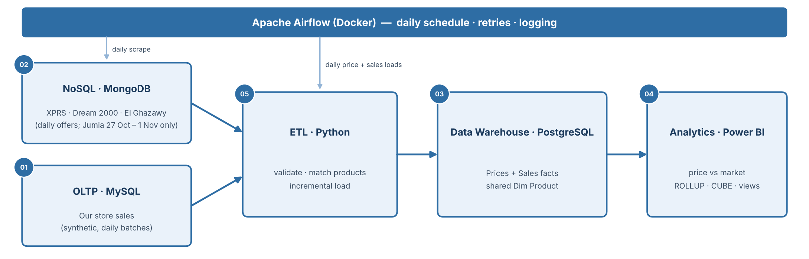

# E-Commerce Data Integration & Analytics Pipeline

An end-to-end data engineering project that **integrates the prices of the same products from three Egyptian online retailers** into one product list, combines them with the sales of our own store, and loads both incrementally into a **PostgreSQL** star-schema warehouse with **Python ETL** orchestrated by **Apache Airflow**, reported with SQL analytics and **Power BI**.

> Graduation project — DEPI Data Engineering track. The module structure follows the reference repository [aymanibrahim/ecommerce](https://github.com/aymanibrahim/ecommerce).

---

## Table of Contents
- [The Problem](#the-problem)
- [Architecture](#architecture)
- [Data Sources](#data-sources)
- [How the Integration Works](#how-the-integration-works)
- [Data Model](#data-model)
- [Tools and Technologies](#tools-and-technologies)
- [Repository Structure](#repository-structure)
- [Project Phases](#project-phases)
- [Current Status](#current-status)
- [How to Run](#how-to-run)
- [Team](#team)
- [Acknowledgements](#acknowledgements)

---

## The Problem

An electronics retailer wants to know **every day how its prices compare with the market**, and how that affects its sales. The same phone or TV is sold on several websites, each with its own page format, product names (Arabic or English) and way of writing model codes — so the data cannot be compared until it is integrated.

## Architecture



## Data Sources

| Source | Access | Lands in | Notes |
|---|---|---|---|
| [XPRS](https://myxprs.com) | Public Shopify JSON (`products.json`) | MongoDB `catalog.offers` | English titles with RAM and storage; replaces 2B, which blocks bots |
| [Dream 2000](https://dream2000.com) | Public Shopify JSON (`products.json`) | MongoDB `catalog.offers` | Arabic titles; SKU often an EAN barcode |
| [Jumia Egypt](https://www.jumia.com.eg) | HTML category pages | MongoDB `catalog.offers` | robots.txt permits identified bots (< 200 requests/min) |
| Our store | Generated CSV files, one batch per day | MySQL `ecommerce_oltp` | **Synthetic** customers and orders on the real products (approved by the instructor) |

Scope: phones and TVs (air conditioners were dropped after the overlap test: only 6 products on 2+ sites). All amounts in Egyptian pounds (EGP). Every column is described in the [data dictionary](docs/data_dictionary.xlsx).

**Polite scraping:** a User-Agent with the bot name and a contact address, one request per second on the JSON sites and one every 3-5 seconds on Jumia, no search or filter URLs, raw pages kept for re-parsing. A site that answers HTTP 403 is never worked around: the scraper stops. Sites whose terms ban scraping, or that block bots, were excluded (B.TECH, 2B, Kimo Store and others).

## How the Integration Works

1. Each site keeps its own structure in MongoDB (HTML vs JSON, Arabic vs English titles).
2. The **matching step** normalises the brand (`سامسونج` → `samsung`) and the model code (removes spaces, hyphens and region suffixes), or — for phones — the model name + RAM + storage.
3. Each real product becomes **one row** in `dim_product` (key `brand | category | model`). The table `product_map` records which offer on which site is which product, and how it was matched (`ean`, `model_code`, `name_spec`, `manual`, `new`).
4. **A new website adds rows, not tables:** a scraper and its list entries only.

Example (overlap test, 25-Oct-2026): *Samsung Galaxy A57 5G 8GB/256GB* — EGP 30,299 on XPRS and EGP 26,295 on Jumia → one product, two offers. The overlap test found 53-63 phones and 19-20 TVs sold on at least two of the three sites.

## Data Model

Two fact tables share the same product and date dimensions:

| Table | Grain |
|---|---|
| `fact_price_daily` | one site offer per day (price, old price, discount, in stock) |
| `fact_sales` | one item in an order of our store (quantity, unit price, line total) |
| `dim_product` · `dim_date` | shared by both facts |
| `dim_site` · `dim_customer` · `product_map` | site, customer, offer-to-product map |

Six reports: cheapest site per product, price spread between sites, discounts over time, stock availability, our sales (synthetic), and **our price against the lowest market price** with the units we sold.

## Tools and Technologies

| Tool | Purpose |
|---|---|
| Python (pandas, requests, BeautifulSoup, mysql-connector-python, psycopg2, pymongo) | Scrapers, sales generator, ETL |
| MySQL | Operational (OLTP) sales database of our store |
| MongoDB | Raw site offers |
| PostgreSQL | Data warehouse (star schema) |
| Apache Airflow | Two daily DAGs with retries and logging |
| Docker Compose | Runs Airflow and the three databases |
| Power BI Desktop | Dashboard |
| DBeaver | Database management (MySQL and PostgreSQL) |
| Git / GitHub | Version control |

## Repository Structure

```
ecommerce-data-pipeline/
├── 01_oltp/          # MySQL: oltp.sql, generate_sales.py, load_batch.py, datadump.sh, backups/
├── 02_nosql/         # MongoDB: common.py, scrapers (XPRS, Dream 2000, Jumia), mongo_load.py, overlap_test.py
├── 03_dwh/           # PostgreSQL: schema.sql, ERD
├── 04_analytics/     # analysis_queries.sql, Power BI dashboard
├── 05_etl/           # matching.py, load_prices.py, automation.py, quality_checks.py, DAGs, config/ (matching lists)
├── docs/             # data_dictionary.xlsx, proposal.pdf, architecture.png
├── docker-compose.yaml · .env.example · requirements.txt · .gitignore
└── README.md
```

Each module folder has a guide (`0X_*.md`) with the steps, commands, outputs and screenshots.

## Project Phases

| Module | Owner | Guide |
|---|---|---|
| 1. OLTP database (MySQL) — our store, synthetic daily batches | Eng. Hussein Saeed | [01_oltp.md](01_oltp/01_oltp.md) |
| 2. NoSQL (MongoDB) — three scrapers, daily offers | Eng. Aya Elgarwany | [02_nosql.md](02_nosql/02_nosql.md) |
| 3. Data warehouse (PostgreSQL) — two facts, shared product dimension | Eng. Hussein Saeed | [03_dwh.md](03_dwh/03_dwh.md) |
| 4. Analytics and dashboard — six reports, Power BI | Eng. Hussein Saeed, Mahmoud Dahroug | [04_analytics.md](04_analytics/04_analytics.md) |
| 5. ETL and pipelines — matching, price and sales loads, two DAGs | Eng. Nouran Elshwehy | [05_etl.md](05_etl/05_etl.md) |

The 36 tasks, owners, due dates and dependencies are in the project tracker (shared with the team).

## Current Status

Last updated: 25-Oct-2026. Design approved by the instructor on 24-Oct-2026. Overlap test done on 25-Oct-2026.

| Part | Status |
|---|---|
| Data dictionary v4, proposal, architecture | Done |
| Docker Compose, connection modules, `etl_state`, `etl_common.py`, scraper helpers (`common.py`) | Ready (reused from the tested previous version) |
| Overlap test (`overlap_test.py` + Colab notebook) | Done: phones and TVs kept, air conditioners dropped |
| MongoDB loader (`mongo_load.py`) | Ready — offline test passes (12 checks) |
| Scrapers, MongoDB loader, matching, ETL, generator, schemas, DAG tasks, SQL reports | Skeletons — being completed (see each file's header for its task and owner) |

## How to Run

1. Clone the repository and copy `.env.example` to `.env` (set `SCRAPER_CONTACT`).
2. `docker compose up -d` — Airflow UI at http://localhost:8081.
3. Create the databases: `01_oltp/scripts/oltp.sql` (MySQL), `03_dwh/scripts/schema.sql` then `05_etl/scripts/etl_state.sql` (PostgreSQL).
4. Unpause `prices_daily_dag` and `sales_daily_dag` in Airflow.
5. Open the Power BI dashboard in `04_analytics/dashboard/`.

> Detailed, tested steps will be completed in Week 4.

## Team

| Member | Role |
|---|---|
| Mahmoud Dahroug | Team Leader & BI |
| Aya Elgarwany | Data Extraction & NoSQL |
| Hussein Saeed | Database Engineer |
| Nouran Elshwehy | ETL & Orchestration |
| Islam Hassan | Documentation & Quality Support |

## Acknowledgements

- Reference structure: [aymanibrahim/ecommerce](https://github.com/aymanibrahim/ecommerce) (IBM Data Engineering Capstone).
- Prices: public product data of XPRS, Dream 2000 and Jumia Egypt, collected for educational use under each site's robots.txt.
- Sales data of "our store" is synthetic and is labelled as such in every report.
