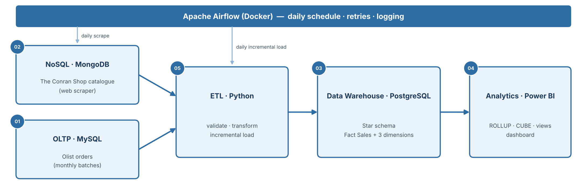

# E-Commerce Data Integration & Analytics Pipeline

A data engineering project that builds an end-to-end e-commerce analytics platform: sales transactions in an operational **MySQL** database, a scraped product catalogue in **MongoDB**, a **PostgreSQL** star-schema data warehouse loaded by incremental **Python ETL** orchestrated with **Apache Airflow**, and a **Power BI** dashboard.

> Graduation project — DEPI Data Engineering track. The module structure follows the reference repository [aymanibrahim/ecommerce](https://github.com/aymanibrahim/ecommerce), using real data instead of synthetic data.

---

## Table of Contents

- [Project Overview](#project-overview)
- [Objectives](#objectives)
- [Architecture](#architecture)
- [Data Sources](#data-sources)
- [Tools and Technologies](#tools-and-technologies)
- [Repository Structure](#repository-structure)
- [Project Phases](#project-phases)
- [How to Run](#how-to-run)
- [Team](#team)
- [Acknowledgements](#acknowledgements)

---

## Project Overview

An e-commerce company records its daily sales in an operational (OLTP) database and collects a product catalogue from a retail website, but management has no single place for reporting. This project builds that platform:

1. Olist sales are loaded into MySQL in monthly batches, to simulate new sales arriving.
2. The Conran Shop Kuwait catalogue is scraped every day into MongoDB.
3. A Python ETL, run by Airflow, moves only the new data into a PostgreSQL star schema.
4. SQL analytics and a Power BI dashboard answer the company's reporting questions.

Amounts are kept in their source currency: BRL for Olist sales and KWD for catalogue prices.

## Objectives

1. Design and populate an OLTP database in MySQL and automate its export.
2. Collect a product catalogue with a permitted web scraper and store it in MongoDB.
3. Design a star-schema data warehouse in PostgreSQL.
4. Build incremental ETL pipelines in Python and orchestrate them with Apache Airflow.
5. Analyse the warehouse with GROUPING SETS, ROLLUP, CUBE and a materialized view, and build a Power BI dashboard.

## Architecture



## Data Sources

| Source | Type | Lands in | Size |
|---|---|---|---|
| [Olist Brazilian E-Commerce dataset](https://www.kaggle.com/datasets/olistbr/brazilian-ecommerce) | CSV files (Kaggle) | MySQL `ecommerce_oltp` | 99,441 orders, 112,650 order items, Sep-2016 to Oct-2018 |
| [The Conran Shop Kuwait](https://www.theconranshop.com.kw/) | Web scraping (collection pages, robots.txt respected) | MongoDB `catalog.products` | About 1,900 products per snapshot |

Every column is described in the [data dictionary](docs/data_dictionary.xlsx).

## Tools and Technologies

| Tool | Purpose |
|---|---|
| Python (pandas, requests, BeautifulSoup, mysql-connector-python, psycopg2, pymongo) | Scraper and ETL scripts |
| MySQL | Operational (OLTP) sales database |
| MongoDB | NoSQL product catalogue |
| PostgreSQL | Data warehouse (star schema) |
| Apache Airflow | Orchestration, scheduling, retries and logging |
| Docker Compose | Runs Airflow and the three databases |
| Power BI Desktop | Business-intelligence dashboard |
| DBeaver | Database management and querying (MySQL and PostgreSQL) |
| Bash, Git / GitHub | Export scripts and version control |

## Repository Structure

```
ecommerce-data-pipeline/
├── 01_oltp/          # Module 1 - MySQL OLTP database
│   ├── 01_oltp.md
│   ├── scripts/      # extract_olist.py, oltp.sql, load scripts, datadump.sh
│   ├── data/         # small samples only
│   └── images/
├── 02_nosql/         # Module 2 - MongoDB catalogue
│   ├── 02_nosql.md
│   ├── scripts/      # Conran scraper, MongoDB queries
│   ├── data/         # catalogue CSV export
│   └── images/
├── 03_dwh/           # Module 3 - PostgreSQL data warehouse
│   ├── 03_dwh.md
│   ├── scripts/      # schema.sql
│   └── images/       # erd.png
├── 04_analytics/     # Module 4 - SQL analytics and Power BI
│   ├── 04_analytics.md
│   ├── scripts/      # analysis queries, materialized view
│   ├── dashboard/    # .pbix file
│   └── images/       # dashboard screenshots
├── 05_etl/           # Module 5 - ETL and Airflow
│   ├── 05_etl.md
│   ├── scripts/      # connection modules, transformations, automation.py
│   ├── dags/         # Airflow DAGs
│   └── images/       # Airflow screenshots
├── docs/             # architecture.png, data_dictionary.xlsx, proposal.pdf
├── .gitignore
└── README.md
```

`docker-compose.yml` and `requirements.txt` will be added at the root with Module 5 setup.

## Project Phases

| Module | Description | Owner | Guide |
|---|---|---|---|
| 1. OLTP database (MySQL) | Design the schema, load the Olist monthly batches, index the purchase timestamp, export with mysqldump | Eng. Hussein Saeed | [01_oltp.md](01_oltp/01_oltp.md) |
| 2. NoSQL catalogue (MongoDB) | Scrape The Conran Shop, import into MongoDB, index, query and export | Eng. Aya Elgarwany | [02_nosql.md](02_nosql/02_nosql.md) |
| 3. Data warehouse (PostgreSQL) | Star schema: Fact Sales, Dim Customer, Dim Product, Dim Date | Eng. Hussein Saeed | [03_dwh.md](03_dwh/03_dwh.md) |
| 4. Analytics and dashboard | GROUPING SETS, ROLLUP, CUBE, materialized view, four company reports, Power BI | Eng. Hussein Saeed, Mahmoud Dahroug | [04_analytics.md](04_analytics/04_analytics.md) |
| 5. ETL and pipelines | Incremental Python ETL and Airflow DAGs with retries and logging | Eng. Nouran Elshwehy, Eng. Aya Elgarwany | [05_etl.md](05_etl/05_etl.md) |

## How to Run

> To be completed in Week 4 (T4.4).

1. Clone the repository.
2. Start the services with Docker Compose.
3. Load the OLTP database (Module 1) and run the first catalogue scrape (Module 2).
4. Create the warehouse schema (Module 3).
5. Unpause the Airflow DAGs (Module 5).
6. Open the Power BI dashboard (Module 4).

## Team

| Member | Role |
|---|---|
| Mahmoud Dahroug | Team Leader & BI |
| Aya Elgarwany | Data Extraction & NoSQL |
| Hussein Saeed | Database Engineer |
| Nouran Elshwehy | ETL & Orchestration |
| Islam Hassan | Documentation & Testing Support |

## Acknowledgements

- Reference structure: [aymanibrahim/ecommerce](https://github.com/aymanibrahim/ecommerce) (IBM Data Engineering Capstone).
- Sales data: Olist, Brazilian E-Commerce Public Dataset, Kaggle.
- Catalogue data: The Conran Shop Kuwait public product pages, collected under the site's robots.txt rules for educational use.
