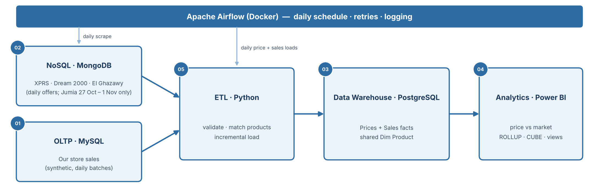

# E-Commerce Data Integration & Analytics Pipeline

**Graduation project — DEPI Data Engineering track**

Mahmoud Dahroug · Aya Elgarwany · Hussein Saeed · Nouran Elshwehy · Islam Hassan

<!-- source: README.md:1,5,134-140 -->

---

# The Problem

An electronics retailer wants to know **every day how its prices compare with the market**, and how that affects its sales.

The same phone or TV is sold on several websites — each with its own page format, product names (Arabic or English) and way of writing model codes — **so the data cannot be compared until it is integrated**.

<!-- source: README.md:27 -->

---

# Objective

To build an **end-to-end e-commerce data integration platform** that:

- collects the prices of the same products from **three Egyptian online retailers**
- matches them into **one product list**
- combines them with the sales of our own store
- loads both **incrementally** into a PostgreSQL **star-schema** data warehouse
- with **Python ETL** orchestrated by **Apache Airflow**
- reported with **SQL analytics** and a **Power BI dashboard**

<!-- source: proposal.pdf:Objective -->

---

# Architecture

Three websites scraped into **MongoDB** and synthetic sales in **MySQL**, integrated by **Python ETL** (product matching + incremental loads) orchestrated by **Apache Airflow** into a **PostgreSQL** warehouse with two fact tables sharing one product dimension, and a **Power BI** dashboard.

<!-- source: proposal.pdf:Figure 1 + README.md:31 -->

---

# Data Sources

| Source | Access | Lands in | Notes |
|---|---|---|---|
| **XPRS** | Public Shopify JSON | MongoDB `catalog.offers` | English titles with RAM/storage |
| **Dream 2000** | Public Shopify JSON | MongoDB `catalog.offers` | Arabic titles; SKU often an EAN barcode |
| **El Ghazawy** | HTML search pages | MongoDB `catalog.offers` | from 9-Nov-2026, in place of Jumia |
| **Jumia Egypt** | HTML category pages | MongoDB `catalog.offers` | 27-Oct to 1-Nov only (HTTP 403 since 2-Nov; not worked around) |
| **Our store** | Generated CSV (one batch/day) | MySQL `ecommerce_oltp` | **Synthetic** customers and orders |

<!-- source: README.md:35-40 -->

---

# Module 01 — OLTP (MySQL)

**Owner:** Hussein Saeed

- Our store's **customers, products, orders, order items** (synthetic, generated as daily CSV files)
- Normalised schema
- Index on the purchase timestamp
- Export script with `mysqldump`

<!-- source: proposal.pdf:Module 01 + README.md:102,138 -->

---

# Module 02 — NoSQL (MongoDB)

**Owner:** Aya Elgarwany

- **Daily offers** from XPRS, Dream 2000 and El Ghazawy (Jumia until 1-Nov)
- Stored as documents in each site's own structure
- Indexes, queries
- Export to CSV

<!-- source: proposal.pdf:Module 02 + README.md:103,137 -->

---

# Module 03 — Data Warehouse (PostgreSQL)

**Owner:** Hussein Saeed

- **Star schema** with two fact tables:
  - `fact_price_daily` (site offer per day)
  - `fact_sales` (item in an order of our store)
- Sharing **dim_product** and **dim_date**
- Plus `dim_site`, `dim_customer`, and an offer-to-product map (`product_map`)

<!-- source: proposal.pdf:Module 03 + README.md:104,138 -->

---

# Module 04 — Analytics & Dashboard

**Owners:** Hussein Saeed, Mahmoud Dahroug

- **SQL:** `GROUPING SETS`, `ROLLUP`, `CUBE`, views, materialized view
- **Six reports:** cheapest site, price spread, discounts, stock, our sales, our price vs market
- **Power BI** dashboard

<!-- source: proposal.pdf:Module 04 + README.md:105,136,138 -->

---

# Module 05 — ETL & Pipelines

**Owner:** Nouran Elshwehy

- **Product matching** (brand + normalised model code)
- **Daily price load** and **incremental sales load**
- **Data validation** and **quality checks**
- Two **Apache Airflow DAGs** with schedules, retries and logging

<!-- source: proposal.pdf:Module 05 + README.md:106,139 -->

---

# Data Model — Star Schema

**Two fact tables share the same product and date dimensions:**

| Table | Grain |
|---|---|
| `fact_price_daily` | one site offer per day (price, old price, discount, in stock) |
| `fact_sales` | one item in an order of our store (quantity, unit price, line total) |
| `dim_product` · `dim_date` | shared by both facts |
| `dim_site` · `dim_customer` · `product_map` | site, customer, offer-to-product map |

<!-- source: README.md:55-64 -->

---

# Reports

**Six reports:**

1. Cheapest site per product
2. Price spread between sites
3. Discounts over time
4. Stock availability
5. Our sales (synthetic)
6. **Our price against the lowest market price** — with units sold

<!-- source: README.md:66 -->

---

# Team & Demo

| Member | Role |
|---|---|
| **Mahmoud Dahroug** | Team Leader & BI |
| **Aya Elgarwany** | Data Extraction & NoSQL |
| **Hussein Saeed** | Database Engineer |
| **Nouran Elshwehy** | ETL & Orchestration |
| **Islam Hassan** | Documentation & Quality Support |

**Final presentation and live demo** — Week 4 deliverable.

<!-- source: README.md:134-140 + proposal.pdf:Week 4 Deliverables -->